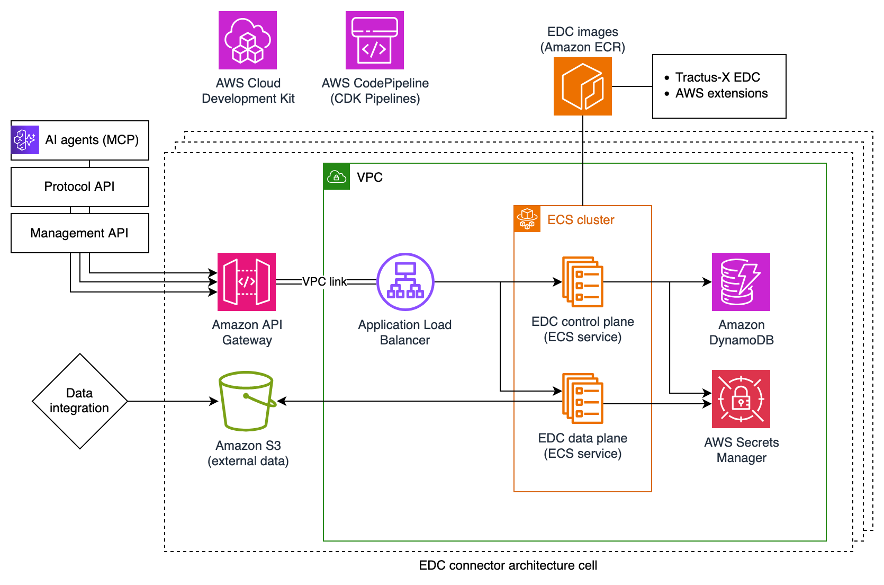

# Dataspace Connector on AWS

🚀 Deploy and manage a fleet of Dataspace Connectors for [Catena-X](https://catena-x.net/) on production-ready AWS infrastructure, from a single connector to hundreds, all managed through configuration.

To participate in secure, sovereign data sharing through the Catena-X data space, member organizations must host a [*Dataspace Connector*](https://eclipse-tractusx.github.io/docs-kits/category/connector-kit). This open-source project provides:

* Production-ready multi-connector deployment on AWS infrastructure, following AWS best practices
* GitOps-driven operations using CDK Pipelines: add or remove connectors by editing YAML files in Git
* Customization for [Tractus-X EDC](https://github.com/eclipse-tractusx/tractusx-edc), with AWS service integrations for [Amazon S3](https://aws.amazon.com/s3/), [AWS Secrets Manager](https://aws.amazon.com/secrets-manager/), and [Amazon DynamoDB](https://aws.amazon.com/dynamodb/)
* Cost-optimized serverless infrastructure targeting <$25/month per connector at scale
* AI-assisted connector management via an included [MCP server](mcp/) and guided [Kiro Power](kiro-power/) workflows for deployment, validation, and operations

> [!IMPORTANT]
> To use this project, your organization must be onboarded to the Catena-X data space. Instructions on how to get started [can be found here](https://catena-x.net/ecosystem/onboarding/). Additionally, operating a connector in the Catena-X production environment requires your organization to pass a [conformity assessment](https://catena-x.net/ecosystem/certification/) conducted by an accredited Conformity Assessment Body (CAB). "Production-ready" in this project refers to AWS infrastructure (fault tolerance, security, observability), not Catena-X certification status.

## Architecture



## Quick Start

### Prerequisites

* Node.js 24+
* AWS CLI configured with credentials for your target account
* A Cofinity-X Portal ([Beta](https://portal.beta.cofinity-x.com/) or [Production](https://myportal.cofinity-x.com/)) account for your Catena-X–onboarded organization

### How It Works

Deployment is fully GitOps-driven via AWS CDK Pipelines. You run `./deploy.sh` once to create the pipeline and a configuration repository, then manage your entire connector fleet by editing YAML files in that repo:

* **Add a connector**: add a `connector-<id>.yaml` file; the pipeline creates its technical user in the Cofinity-X Portal, registers it for discovery, and provisions its infrastructure.
* **Remove a connector**: delete its YAML file; the pipeline tears down its stack, which deletes its portal registration and technical user. With `stateRemovalPolicy: RETAIN` (the default) its DynamoDB table and S3 bucket stay in your account.
* **Upgrade the connector software**: bump `appVersion` in `pipeline.yaml`; the pipeline rebuilds and redeploys all connectors.

### Deploy the Pipeline

**1. Create the portal admin technical user.** In the Cofinity-X Portal, create an internal technical user with the **Connector Management** role (see [Cofinity-X Portal Setup](docs/cofinity-x-portal-setup.md)). The pipeline uses it to create each connector's technical user and register the connector for discovery. Store its credentials in AWS Secrets Manager as `<deploymentName>/portal-admin/<BPNL>` (default `deploymentName`: `DataspaceConnector`):

```bash
aws secretsmanager create-secret --name DataspaceConnector/portal-admin/<BPNL> \
  --secret-string '{"clientId":"<client-id>","clientSecret":"<client-secret>"}'
```

A deployment that hosts connectors for more than one organization needs one admin technical user and one secret per organization (BPNL).

**2. Run the deploy script:**

```bash
export AWS_PROFILE=<your-profile>
export AWS_REGION=eu-central-1
./deploy.sh
```

This bootstraps the account, deploys the pipeline stack, and creates a CodeCommit configuration repository pre-populated with template YAML files. Alternatively, you can configure your existing GitHub repository.

**3. Configure and push.** Clone the config repo, edit the YAML files (see [Configuration](#configuration)), and push:

```bash
git clone codecommit::eu-central-1://<your-profile>@DataspaceConnector-config
cd DataspaceConnector-config
# edit pipeline.yaml, deployment.yaml, and connectors/*.yaml
git add -A && git commit -m "Initial configuration" && git push origin main
```

The pipeline run deploys the shared infrastructure and every connector. The portal takes several minutes to create a connector's technical user, so a connector's first deploy takes correspondingly longer. All later changes flow through Git pushes to the config repository.

## AI-Assisted Connector Management

This project includes tooling for AI-assisted deployment and operation:

* **[MCP Server](mcp/)**: A Model Context Protocol server with 12 tools for interacting with the EDC Management API. Create assets, negotiate contracts, transfer data, and troubleshoot, all through natural language.

* **[Kiro Power](kiro-power/)**: Guided workflows for [Kiro](https://kiro.dev) that walk you through deploying your connector and validating end-to-end data exchange, including S3 loopback testing.

## Configuration

The configuration repository has three parts:

```
your-config-repo/
├── pipeline.yaml            # Pipeline settings
├── deployment.yaml          # Shared infrastructure + portal integration
└── connectors/
    ├── connector-ccm.yaml   # One file per connector
    ├── connector-pcf.yaml
    └── connector-dpp.yaml
```

The templates in [`cdk/config-templates/`](cdk/config-templates/) list every key: required keys with an example value, optional keys commented out with their default.

### `pipeline.yaml`

| Key | Required | Default | Description |
|---|---|---|---|
| `appRepo` | yes | | Public GitHub repository of the app (`owner/name`). |
| `appVersion` | yes | | Git tag, branch, or commit hash to deploy. |
| `configSource` | | `codecommit` | `codecommit` (created by `deploy.sh`) or `github`. |
| `configRepoName` | for `github` | | Configuration repository (`owner/name`). |
| `connectionArn` | for `github` | | AWS CodeConnections connection ARN for that repository. |
| `deploymentName` | | `DataspaceConnector` | Prefixes every resource (pipeline, stacks, configuration repository, secrets), so independent deployments can share one account and region. Set it once, before the first deploy. |
| `requireApproval` | | `false` | Adds a manual approval step before each deploy. |

### `deployment.yaml`

Shared infrastructure plus Cofinity-X Portal integration. The pipeline derives each connector's EDC identity from the portal environment, the connector's BPNL, and its technical user.

| Key | Required | Default | Description |
|---|---|---|---|
| `portal.environment` | yes | | Cofinity-X Portal environment: `beta` or `production`. |
| `portal.bpnl` | unless every connector sets `bpnl` | | Default BPNL of every connector. |
| `profile` | | `development` | Shared infrastructure and BaSyx: `development` (1 NAT gateway, Fargate Spot) or `production` (2 NAT gateways, On-Demand). See [Deployment Profiles](#deployment-profiles). |
| `vpcIpAddresses` | | `10.0.0.0/20` | VPC CIDR. |
| `containerInsights` | | `false` | Amazon CloudWatch Container Insights on the ECS cluster. |
| `managementApiPrincipals` | | none | IAM principal ARNs allowed by the Management API's resource policy (IAM auth). |
| `observabilityApiPrincipals` | | none | Same for the Observability API. |
| `logLevel` | | Tractus-X default | EDC log level of all connectors: `TRACE`, `DEBUG`, `INFO`, `WARN`, `ERROR` or `OFF`. `DEBUG` and `TRACE` also turn on API Gateway data tracing, which logs full request and response bodies, including tokens, to CloudWatch. Don't use them in production. |
| `stateRemovalPolicy` | | `RETAIN` | Whether stored state (each connector's DynamoDB table and S3 bucket, each BaSyx database) is kept (`RETAIN`) or deleted (`DESTROY`) with its stack. |
| `certificateArn`, `domainName`, `hostedZoneId` | all or none | | Custom domain, see [Custom Domain](#custom-domain). |
| `basyx` | | | Digital Twin Registry per BPNL, see [Digital Twin Registry](#digital-twin-registry-eclipse-basyx). |

### `connectors/connector-<id>.yaml`

For each connector the pipeline creates a Cofinity-X Portal technical user (**Identity Wallet Management** role) named `<deploymentName>-<connectorId>`, stores its OAuth client secret in AWS Secrets Manager, and registers the connector for discovery, with no manual steps.

| Key | Required | Default | Description |
|---|---|---|---|
| `connectorId` | yes | | Unique connector ID, 2-60 lowercase letters, digits and hyphens. `basyx` is reserved. |
| `bpnl` | | `portal.bpnl` | The connector's BPNL, to host connectors of more than one organization in one deployment. |
| `profile` | | `production` | `production` (On-Demand, 1-month logs) or `development` (Fargate Spot, 1-week logs), independent of the deployment `profile`. |
| `controlPlaneCpu`, `controlPlaneMemoryLimitMiB` | | `256`, `1024` | Control plane Fargate task size. |
| `dataPlaneCpu`, `dataPlaneMemoryLimitMiB` | | `256`, `512` | Data plane Fargate task size. |
| `interactiveStateMachineIterationMillis` | | `10000` | Iteration interval of the negotiation, transfer and data-flow state machines. |
| `backgroundStateMachineIterationMillis` | | `60000` | Iteration interval of the policy monitor and data-plane selector. |
| `dataPlaneFlowLeaseMillis` | | `10000` | How often an open PULL flow renews its lease (one DynamoDB write). After 5 missed renewals another data plane may take the flow over. |
| `stateRemovalPolicy` | | deployment value | Overrides `stateRemovalPolicy` for this connector. |
| `logLevel` | | deployment value | Overrides `logLevel` for this connector. |

### Custom Domain

When all three optional fields (`certificateArn`, `domainName`, `hostedZoneId`) are provided in `deployment.yaml`, the stack creates an API Gateway custom domain and maps EDC APIs as base paths (`/status`, `/management`, `/protocol`, `/data`). The default `execute-api` endpoints are disabled. The AWS Certificate Manager certificate must be in `us-east-1` regardless of stack region (API Gateway requirement for edge-optimized endpoints).

### Digital Twin Registry (Eclipse BaSyx)

An optional `basyx` block in `deployment.yaml` deploys an [Eclipse BaSyx](https://github.com/eclipse-basyx/basyx-go-components) Digital Twin Registry (DTR), and optionally a Submodel Repository, for a BPNL. It is keyed by BPNL:

| Key | Required | Default | Description |
|---|---|---|---|
| `basyx.<BPNL>.services` | yes | | `[dtr]` or `[dtr, submodelRepository]`. |
| `basyx.<BPNL>.dtrConnector` | | the BPNL's first connector by file name | Connector that offers the DTR in its catalog. |
| `basyx.<BPNL>.profile` | | deployment `profile` | Overrides `profile` for this BaSyx stack. |
| `basyx.<BPNL>.stateRemovalPolicy` | | deployment value | Overrides `stateRemovalPolicy` for this BaSyx database. |

Each listed BPNL gets its own `<deploymentName>-BaSyx-<BPNL>` stack with an Aurora Serverless v2 PostgreSQL cluster, an Amazon Cognito user pool for machine-to-machine tokens, and one ECS service per BaSyx service. The services sit behind the shared internal load balancer under `/basyx/<BPNL>/dtr/api/v3` and `/basyx/<BPNL>/smrepo`. The pipeline offers the DTR as the catalog asset `dataspace-connector-dtr` on the `dtrConnector`, whose data plane reads it with a Cognito token that grants read access. You can add a `basyx` entry for a connector that is already running; the stack is created on the next pipeline run.

#### Registering twins and submodels

The pipeline creates the services empty. Your applications write shell descriptors and submodels through the management API, signed with SigV4 and carrying a BaSyx writer token. [Digital Twins with Eclipse BaSyx](docs/digital-twins-with-basyx.md) walks through the provider and consumer steps with examples.

Things to know:

- **Removing a `basyx` entry:** the pipeline deletes the DTR asset and the BaSyx stack. With `RETAIN`, the Aurora cluster and its credentials secret stay in your account. Like a retained connector's DynamoDB table, the retained cluster keeps its fixed name, so delete it manually before adding the BPNL again.
- **Idle cost:** the cluster is configured to pause at 0 ACU, but the DTR runs a database maintenance job every minute, so expect it to stay at its 0.5 ACU minimum.
- **Token rate:** each data plane task caches the Cognito token until shortly before it expires, so it requests about one token per hour.

## Teardown

To completely remove all deployed resources, follow these steps in order:

**1. Remove the `basyx` block and all connector YAML files** from the config repo and push. The pipeline's cleanup step destroys the BaSyx and connector stacks, which deregisters the connectors from the portal.

**2. Delete the shared infrastructure stack** (removes the network, the load balancer and the APIs):

```bash
aws cloudformation delete-stack --stack-name DataspaceConnector-SharedInfra --region <region>
```

**3. Delete the pipeline stack** (removes the pipeline and the configuration repository):

```bash
aws cloudformation delete-stack --stack-name DataspaceConnectorPipelineStack --region <region>
```

Stack and repository names are prefixed by `deploymentName` (default `DataspaceConnector`); substitute your own if you set it. Finally delete the portal admin secrets you created and any retained tables, buckets and Aurora clusters.

## Deployment Profiles

| Setting | `development` | `production` |
|---------|--------------|--------------|
| VPC | 2 AZs, 1 NAT Gateway | 2 AZs, 2 NAT Gateways (HA) |
| Fargate | Spot (70% cheaper) | On-Demand |
| Log retention | 7 days | 30 days |

### Estimated Monthly Cost (eu-central-1)

| Connectors | `development` | `production` |
|-----------|---------------|--------------|
| 1 | ~$50/month | ~$80/month |
| 10 | ~$10/connector | ~$15/connector |
| 100 | ~$7/connector | ~$12/connector |

Baseline infrastructure cost drops significantly at scale because VPC, NAT Gateway, and ALB are shared. Per-connector cost is primarily Fargate compute + DynamoDB on-demand.

These figures reflect baseline (idle) cost. DynamoDB consumption, and therefore variable cost, scales with the number of active (open) transfers a connector serves. See [Open Transfers and DynamoDB Cost](docs/open-transfers-and-dynamodb-cost.md).

## Considerations

* **Per-connector access control:** When deploying multiple connectors, you can restrict which IAM principals can access which connector's Management API. Supports single-account, cross-account, and organization-level trust patterns. See [Management API Access Patterns](docs/management-api-access-patterns.md).
* **API Gateway payload limit:** 10 MB per request (REST API). Does not affect *Consumer Pull* scenarios or S3-backed data transfers.
* **Exposed API surface:** The OpenAPI specs in `cdk/api/` expose every route Tractus-X serves on the management, protocol, public data-plane and health contexts, with request validation on parameters and bodies. For production, remove the routes your applications do not call. After an EDC upgrade, regenerate the specs with `scripts/regenerate-api-specs.py`. The internal control APIs between the planes, version details, and the data-plane management and consumer proxy contexts are not exposed. The federated catalog is not supported: its catalog context is not configured and Tractus-X ships it disabled.
* **Open transfers accrue provider cost:** Pull transfers remain `STARTED` until explicitly terminated, and each open transfer keeps a provider-side data-plane flow active and consuming DynamoDB. Terminate transfers you no longer need via the Management API. See [Open Transfers and DynamoDB Cost](docs/open-transfers-and-dynamodb-cost.md).
* **Fargate Spot availability:** In `development` profile, Spot capacity constraints may cause deployment delays during updates. Retry or use `production` profile for guaranteed placement.

## Learn More

* [Minimum Viable Dataspace on AWS](https://github.com/awslabs/minimum-viable-dataspace-on-aws)
* [Eclipse Dataspace Components on AWS: Data sharing fundamentals](https://aws.amazon.com/blogs/architecture/eclipse-dataspace-components-on-aws-data-sharing-fundamentals/) (3-part blog series)
* [AWS-specific service integrations for EDC](https://github.com/eclipse-edc/Technology-Aws)
* [Aspect Models for Eclipse Tractus-X Semantic Layer (SLDT)](https://github.com/eclipse-tractusx/sldt-semantic-models/)

## Backlog / Ideas 💡

* Deployment of the entire [Tractus-X Hausanschluss](https://github.com/eclipse-tractusx/tractus-x-umbrella/blob/main/docs/user/common/guides/hausanschluss-bundles.md)
* Configurable switch between DynamoDB and Aurora PostgreSQL for control plane persistence
* Data plane extension to serve DynamoDB data as EDC asset type

## Security

See [CONTRIBUTING](CONTRIBUTING.md#security-issue-notifications) for more information.

## License

This project is licensed under the Apache-2.0 License.
