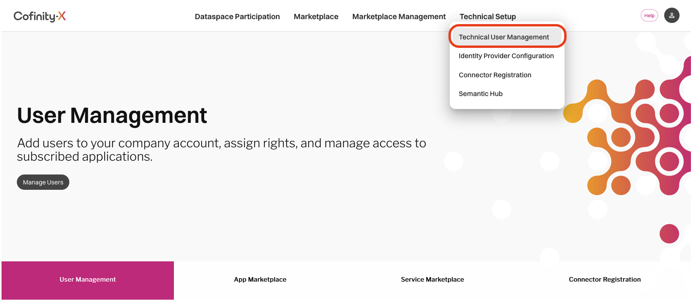

# Cofinity-X Portal Setup

_Dataspace Connector on AWS_ manages each connector's Cofinity-X Portal lifecycle itself: it creates the connector's technical user (**Identity Wallet Management** role), stores its OAuth client secret in AWS Secrets Manager, derives the connector's EDC identity, and registers the connector for discovery. Removing a connector deletes the registration together with its technical user.

It does this as one internal **admin technical user** per organization (BPNL), which you create once in the portal [Beta](https://portal.beta.cofinity-x.com/) or [Production](https://myportal.cofinity-x.com/).

## Prerequisites

- Your organization is onboarded to the Catena-X data space and has a wallet
- Your organization has the **Active Participant** company role, which the portal requires to offer the **Connector Management** technical user role
- You have access to the relevant Cofinity-X Portal instance

## Step 1: Create the admin technical user

From the Cofinity-X Portal, open **Technical Setup** in the top navigation bar and select **Technical User Management**.



Create a technical user with the **Internal technical user profile** and only the **Connector Management** role. Copy its **Client ID** and **Secret**.

## Step 2: Store its credentials

Store the credentials in AWS Secrets Manager under `<deploymentName>/portal-admin/<BPNL>` (default `deploymentName`: `DataspaceConnector`), before the first pipeline run that deploys a connector of this BPNL:

```bash
aws secretsmanager create-secret --name DataspaceConnector/portal-admin/<BPNL> \
  --secret-string '{"clientId":"<client-id>","clientSecret":"<client-secret>"}'
```

To rotate the secret, update the value; the next connector create or update uses it.

## What the pipeline derives

| EDC property                         | Value                                                      |
| ------------------------------------ | ---------------------------------------------------------- |
| `tractusx.edc.participant.bpn`       | The connector's BPNL (`bpnl`, else `portal.bpnl`)          |
| `edc.iam.issuer.id`                  | The company DID the portal hosts for the BPNL              |
| `edc.iam.trusted-issuer.issuer-1.id` | The portal operator's DID                                  |
| `tx.edc.iam.iatp.bdrs.server.url`    | The portal environment's BPN/DID Resolution Service (BDRS) |
| `tx.edc.iam.sts.dim.url`             | The wallet (DIM) service, the same for Beta and Production |
| `edc.iam.sts.oauth.client.id`        | The connector's technical user                             |
| `edc.iam.sts.oauth.token.url`        | The connector's technical user                             |

## See Also

- [`deployment.yaml` configuration reference](../README.md#deploymentyaml)
- [`connectors/connector-<id>.yaml` schema](../README.md#connectorsconnector-idyaml)
