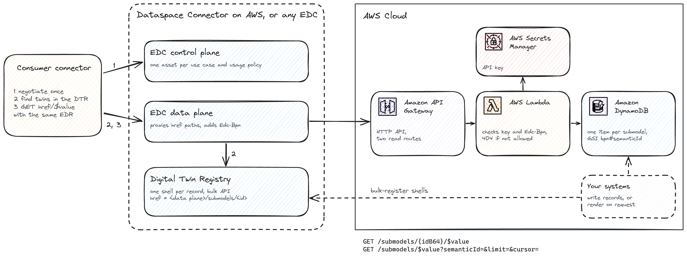

# Submodels at Scale

This note collects best practices for keeping performance and resource use under control when you transfer high data volumes over EDC, and describes an AWS-native submodel service as an alternative to the BaSyx Submodel Repository.

## Bundle submodels into one asset

Negotiation cost grows with the number of assets, not with the number of records. Offer one `HttpData` asset per use case and usage policy, with `baseUrl` at the submodel service root and `proxyPath` and `proxyQueryParams` set to `true`. Each submodel descriptor in the Digital Twin Registry (DTR) then points at the same asset and selects its record by path:

- `subprotocolBody`: `id=<assetId>;dspEndpoint=<providerDspUrl>`
- `href`: `<providerDataPlanePublicUrl>/submodels/<submodelIdB64>`

A consumer negotiates once, starts one transfer and reuses its EDR for every `href` with that asset ID. In our tests a negotiation plus transfer took about 30 seconds, so one asset per record does not scale.

One agreement now covers every record of the asset, so the submodel service decides which records a consumer may read. The Tractus-X data plane adds the consumer's BPNL from the agreement as `Edc-Bpn` to every request, and `Edc-Contract-Agreement-Id` when access depends on the specific agreement.

## Prefer bulk and paged calls

Single calls add a round trip through the data plane per record. Prefer the bulk and paging operations of the AAS API:

| Task | Use | Measured |
|---|---|---|
| Register twins | `POST /bulk/shell-descriptors` (asynchronous) | 1,000 shells in 8.9 s |
| Find new twins | `POST lookup/shellsByAssetLink?createdAfter=<RFC 3339>` | 2,000 IDs in 3 calls, 0.4 s |
| Read descriptors | `GET shell-descriptors?limit=1000` | 2,000 descriptors in 3 calls, 1.5 s |
| Read submodels | `GET submodels/$value?semanticId=<referenceB64>&limit=` | 100 submodels in 2 calls |

`semanticId` is the base64url-encoded JSON Reference `{"type":"ExternalReference","keys":[{"type":"GlobalReference","value":"<semanticId>"}]}`, not the plain IRI.

## Size the data plane

Every submodel request passes through the provider data plane. We ran load tests with two data plane sizes on one connector; your results depend on backend, payload size and request mix.

| `dataPlaneCpu` / `dataPlaneMemoryLimitMiB` | Warm task | Newly started task under load |
|---|---|---|
| `256` / `512` (default) | 80-160 requests/s | Stayed CPU-bound for more than 10 minutes; adding a second task lowered total throughput |
| `1024` / `2048` | 360+ requests/s | Warm after about 1 minute; two tasks reached 440 requests/s |

In these tests each proxied request cost 0.5 DynamoDB read capacity units. For high-volume exchanges, raise `dataPlaneCpu` before adding tasks, and terminate transfers you no longer pull from (see [Open Transfers and DynamoDB Cost](open-transfers-and-dynamodb-cost.md)).

## AWS-native submodel service

A submodel service built on Amazon API Gateway, AWS Lambda and Amazon DynamoDB fits when your data already lives on AWS: records are read from your own tables or rendered on request, nothing is copied into a separate submodel store, and there is no idle compute. The BaSyx Submodel Repository fits when you want the full AAS API, including writes, without writing code.

### API

CX-0002 requires the read operations of the Submodel Service Value Profile. A read-only service needs these routes:

| Route | Required | Behavior |
|---|---|---|
| `GET /submodels/{idB64}/$value` | yes | Value-only JSON, or `404` when the record does not exist or `Edc-Bpn` may not read it |
| `GET /submodels/$value?semanticId=&limit=&cursor=` | no | Paged value-only JSON of every record `Edc-Bpn` may read |
| any other route | | `501 Not Implemented` |

Things to know:

- **Denials:** return `404`, not `403`, so callers cannot probe for record IDs, and offer no unfiltered list. The data plane reports any backend `4xx` to the consumer as `500`.
- **Authentication:** the data plane sends a static API key from its vault on every request, so no token endpoint is involved. See [EDC Asset Examples](edc-asset-examples.md#api-key-protected-http-api).

### DynamoDB layout

| Attribute | Value |
|---|---|
| `id` (partition key) | Submodel ID |
| `bpns` | BPNLs allowed to read the record |
| `value` | Value-only JSON |
| GSI `gsiPk` / `gsiSk` | `<BPNL>#<semanticId>` / `<createdAt>#<id>` |

The `GetItem` on `id` serves single reads; a `Query` on the GSI serves paging and new-records-first reads. A record readable by several BPNLs needs one GSI item per BPNL.

## See Also

- [Digital Twins with Eclipse BaSyx](digital-twins-with-basyx.md): publishing and reading twins and submodels with the BaSyx services
- [EDC Asset Examples](edc-asset-examples.md): asset definitions for BaSyx, API key-protected backends and Amazon S3
- [CX-0002 Digital Twins in Catena-X](https://catenax-ev.github.io/docs/standards/CX-0002-DigitalTwinsInCatenaX): submodel descriptor and Submodel API requirements
